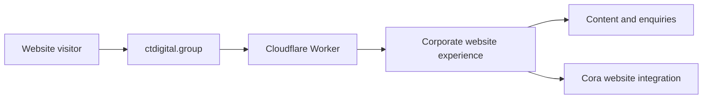

# CT DIGITAL GROUP
### Corporate Website · Cloudflare Worker · AI-Enabled Experiences

**Practical AI. Useful systems. Built to do real work.**

**UK-operated · AI operations · Digital infrastructure · Automation · Publishing**

---

## A digital group built around useful technology

**CT DIGITAL GROUP** builds and operates businesses across AI-enabled growth, websites, infrastructure, publishing and digital commerce.

This repository documents the development of our [corporate website](https://ctdigital.group/): the public-facing home of the group, its capabilities and its AI-powered reception experience.

The site is designed to make sophisticated technology approachable, with a distinctive dark visual identity, considered interactions and a clear route from curiosity to conversation.

> **Live website:** [ctdigital.group](https://ctdigital.group/)
> **Status:** Public source repository · Independently deployed production website

## The experience

| Focus | What it means |
|:--|:--|
| **Brand and design** | Deep-navy visual language, luminous cyan accents, layered interfaces and responsive layouts |
| **Company and capabilities** | A clear introduction to the group, its work and its operating approach |
| **Cora — AI receptionist** | A voice-and-chat enquiry experience integrated into the website |
| **Discoverability** | Search-friendly page structure, metadata and machine-readable signals |
| **Practical interaction** | Fast routes to information, services and contact without unnecessary friction |
| **Trust and clarity** | Accessible information about the business and its policies |

These describe the website's intended and developed experience; this repository alone is not a substitute for live functional testing.

## How it is delivered

The production website is served through **Cloudflare Workers**, not GitHub Pages.

The production Worker is named `ctdigital-group-services`. The `worker.js` file in this repository was imported from the deployed Worker on **21 November 2026** and verified against the retrieved source by SHA-256 at the time of import.

**The repository is a source-control baseline, not an automatic deployment pipeline.** Later changes made directly in Cloudflare may not be represented here until they are explicitly synchronised.

## Repository guide

| Path | Purpose |
|:--|:--|
| [`worker.js`](./worker.js) | Verified production Worker source snapshot |
| [`.github/workflows/verify-worker.yml`](./.github/workflows/verify-worker.yml) | Automated JavaScript syntax check |
| [`README.md`](./README.md) | Public project overview and development notes |

This public repository does **not** include private Cloudflare bindings, runtime secrets, customer records or separately deployed Cora/operational backends.

## Development quality

Changes proposed through a pull request to `main` run a read-only syntax verification workflow:

- GitHub Actions checks out the repository without retaining checkout credentials.
- Node.js validates `worker.js` using `node --check`.
- The workflow **does not** deploy or make changes to the production Worker.

A passing syntax check does not guarantee that every route, accessibility feature, SEO element or Cora interaction works. Those require separate functional testing.

### Working principles

1. **Protect production.** A GitHub push is not permission to deploy.
2. **Verify before changing.** Compare against the latest live Cloudflare source before implementing updates.
3. **Keep secrets out of Git.** Never commit credentials, environment files, customer information or private infrastructure exports.
4. **Review changes.** Prefer focused commits, tests and an inspectable development history.
5. **Make useful improvements.** Design, reliability, accessibility and performance matter together.

## Development milestones

- **Production source archived:** Verified Cloudflare Worker snapshot imported on 21 November 2026.
- **Git-based workflow established:** A reviewable history of future website updates.
- **Automated syntax verification:** GitHub Actions workflow added and tested successfully.
- **Public technical showcase:** Source available for visitors to inspect without publishing private operational systems.

## Explore CT DIGITAL GROUP

### See the website in action

[**Visit CT DIGITAL GROUP**](https://ctdigital.group/) · [**Meet Cora**](https://ctdigital.group/blog/meet-cora-ai-receptionist) · [**Founder on GitHub**](https://github.com/colintandyonline)

---

**Building. Testing. Improving.**

Public development where appropriate. Sensitive systems and data stay protected.

